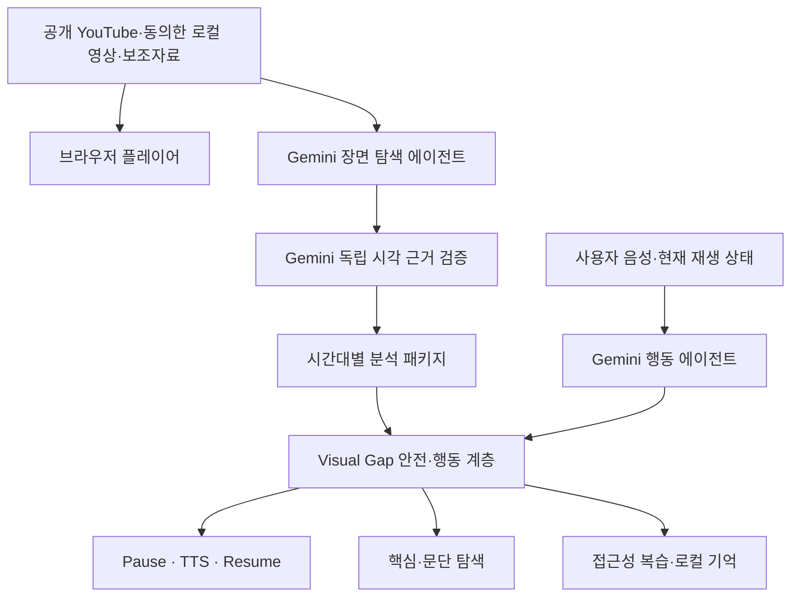
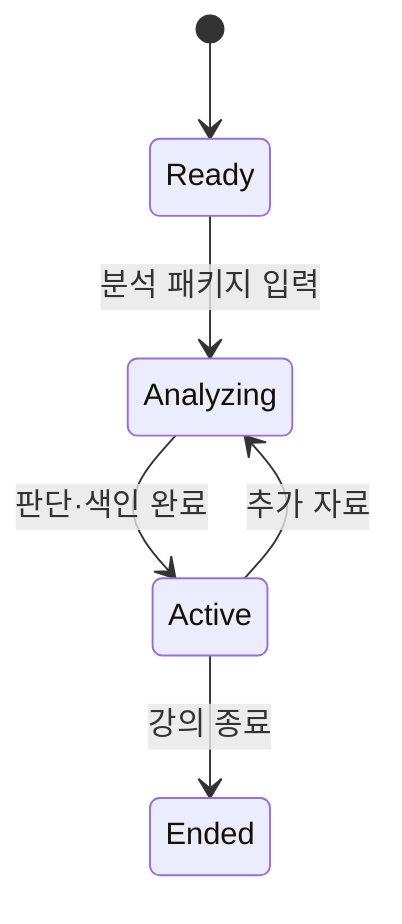

# 아키텍처

## 전체 흐름

영상 파일의 재생 사본은 `URL.createObjectURL`로 브라우저에 남는다. 기본값에서는 API에 파일 이름·형식·크기 같은 메타데이터만 전달한다. 사용자가 `실제 발화·판서·슬라이드 임시 분석`에 별도로 동의한 경우에만 API가 원본을 임시 파일로 받아 Gemini Files API에 전달한다. 분석 성공·실패와 관계없이 로컬 임시 파일을 지우고, Gemini 파일도 즉시 삭제 요청한다. 공급자 삭제가 실패해도 Files API의 자동 삭제 상한은 48시간이다.

## 구성 요소

| 위치 | 책임 |
| --- | --- |
| `apps/web/index.html` | 업로드, 플레이어, 지문 탐색, 복습, 판단 근거 |
| `apps/web/app.js` | 로컬 영상, API 연결, 타임라인, TTS, Space 길게 누르기 음성 명령 |
| `adapters/video_link.py` | 공개 링크와 동의한 로컬 영상의 Gemini 임시 업로드, 장면 탐색, 독립 시각 근거 재검증, 삭제 |
| `adapters/gemini_agent.py` | 현재 강의 상태를 바탕으로 다음 도구 행동 선택 |
| `core/lecture_agent.py` | 세션·자산·분석·복습 오케스트레이션 |
| `core/visual_gap.py` | 발화 중복, 중요도, 확신도, 정답 차단, 판서 변화 판단 |
| `core/passage.py` | 문단·문장·흐름 구조화와 위치 탐색 |
| `adapters/interfaces.py` | 실제 STT/OCR·멀티모달 공급자 경계 |
| `core/demo.py` | API 키 없이 재현하는 명시적 샘플 |

## 에이전트 상태 전이

## 안전한 출력 경로

`VisualObservation`은 곧바로 UI나 TTS로 가지 않는다. `analyze_visual_observation`이 `VisualGap`을 만들고 `safe_to_speak`가 참인 경우만 공개 설명을 포함한다. `HOLD`는 `public_description=""`과 `source_text=None`을 강제하므로 프런트엔드 실수로 원 후보가 새기 어렵다.

## 실제 모델 연결

`GEMINI_API_KEY`가 있으면 공개 YouTube 영상과 별도 전송 동의가 있는 로컬 영상은 두 개의 분리된 모델 단계로 처리한다. 로컬 영상은 Files API에서 `ACTIVE`가 될 때까지 기다린 뒤 같은 분석 경로를 사용한다.

1. 장면 탐색 에이전트가 장면 전환과 발화를 따라 분석 시점을 유동적으로 고르고 전사·판서·그래프·지문·중요도·권장 행동을 만든다.
2. 독립 시각 근거 에이전트가 같은 영상을 다시 보며 후보 장면을 반증하고 `confirmed`, `corrected`, 삭제 중 하나를 선택한다.
3. 화면에서 직접 확인한 글자·도형·축·화살표 목록이 없는 항목은 확신도를 0.69 이하로 내려 `HOLD`시킨다.
4. 검증된 Gemini 행동 제안만 코어에 들어오며, 개인정보·낮은 확신도·문제 보호·발화 중복 정책은 모델과 독립적으로 다시 적용한다.

학습 대화는 별도의 Gemini 행동 에이전트가 현재 재생 위치와 안전하게 정리된 강의 상태를 관찰하고 답변, 요약 낭독, 구간 이동, 현재 화면 해설, 문단 재청취, 정지 중 한 행동을 고른다. 기반 모델을 새로 학습한 것이 아니라 Gemini API에 Sullivan의 도구, 상태, 기억과 안전 경계를 결합한 에이전트 시스템이다.

## 현재 저장 방식

대회 MVP는 프로세스 메모리 저장소다. 서버를 재시작하면 세션이 사라진다. 운영 전에는 암호화된 세션 저장, 사용자 삭제, 보존 기간, 접근 통제, 감사 로그가 추가되어야 한다.
